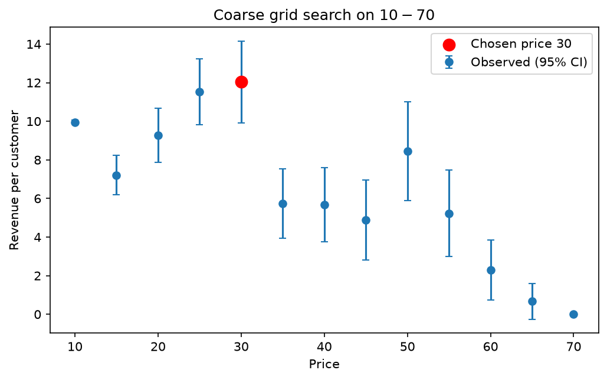
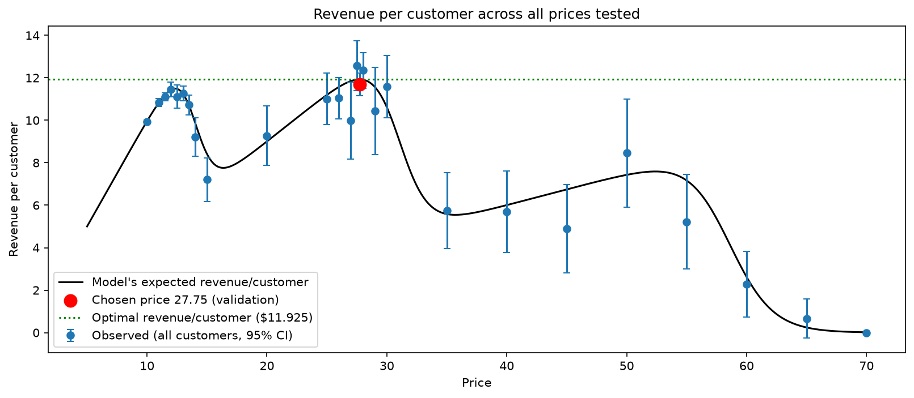

# Finding the Revenue-Maximizing Price Through Sequential Experimentation

## 1. Summary of the Problem

Our task was to find the optimal the price between \$0 and \$70 that maximizes the expected revenue per arriving customer. Using simulations of new customers with the 'sales' function, we set a price and observe the number of purchasing customers adn revenue (a random sample seed is set so that all reruns produce the same results). With this as the foundation of our exploration, we carefully searched for the optimal price keeping in mind that every new customer came as a cost. A customer shown a bad price is revenue we never get back, so our methods aimed at minimizing the number of customers used before settling at an optimal price. However, to be confident that one price beats another, we need enough customers for the test to have reasonable power (the high chance of detecting a real difference). Demanding a stricter significance level (like 95% vs. 90%) widens confidence intervals and raises the sample size needed even further. Too few customers means we risk settling on a false peak, the revenue curve has several local peaks (Figure 2), so a search can easily stop at the wrong one. Too many means we waste revenue confirming differences that are irrelevant. Our search therefore tried to balance three main levers: confidence in the final optimal price based on power and significance, the number of customers used, and the revenue forfeited through testing.

## 2. How Our Design Handles Uncertainty while Selecting Prices

Our design moves from cheap broad exploration to a narrow expensive exploration. By spending more customers only where the revenue is maximized, we are less concerned with the cost of testing on new customers because the revenue we are missing out on is small. In Step 1 of our model, we conduct a coarse grid search from \$10 to \$70 in \$5 steps with about 250 customers per price, see Figure 1. This showed two promising regions, one near \$10–\$15 and one near \$25–\$30, but one was not clearly better than the other (Figure 1). It also showed a smaller bump near \$55, which \$25 beat significantly so we ignored it. Step 2 of our model does a finer grid search on these local maximas to determine a narrower range for the optimal price: \$1 grids over \$10–\$14 and \$25–\$30. The best prices found were \$13 and \$28, see Figure 2. Step 3 used Lehr's rule to compute how many customers it would take to separate nearby prices within these small ranges. For \$26 vs. \$28 the estimate were highly variable, goingover 100,000 customers per price quite freuently depending on the random sample. This happened because the observed difference delta appears squared in the denominator, so when two prices earn almost the same revenue a tiny delta explodes. Because finding the optimal price with confidence there would require a massive amount of customers to experiment on, Step 4 used successive elimination on a half-dollar scale for the regions around \$13 and \$28 to answer the question that actually matters: which region holds the global optimum. It found that the optimal price was in \$28 region, but the exact $0.50 scale jumped around depending on the chosen batch size, confidence level, and maximum number of rounds. Lastly, Step 5 validated the chosen optimal price from successive elimination on a fresh sample of customers, confirming that this revenue was optimal and not a lucky survivor.

To combat the complexity of all this uncertainty, helper funciton were defined at the start of the notebook. The main uncertaintly lied in the expected revenue from different prices. The samples drawn from the sales function are noisy, so we created a pairwise decisions funciton which used a two-sample Z-test with unequal variances, with bootstrapping of 5,000 samples and a 95% interval for each resample. It declare a winning price only if one price is significantly better in more than half of the resamples. Inconclusive resamples counted against both prices, so a few lucky resamples cannot decide the outcome (like 1 positive, and 4999 unknown). Using this helper funciton allowed us to utilize bootstrapping and a strict confidence interval to be confident in our selected better price. There was also uncertaintly in our grid search, specifically when one price was not significantly better than another. Our grid search funciton kept whichever price had the higher observed average, so it did not waste resources tyring to settle tiny differences. Furthermore, we used 95% confidence (z = 1.96) throughout our model. Lowering the confidence level would have saved customers, but in the high-revenue regions the standard errors are large, a looser threshold made it more likely that we would drop the true best price by mistake. We were also not too worried about larger sample sizes around optimal prices because they came at smaller costs, so using a stronger confidence level was not necessarily costly once we narrowed down our search. For power, we used Lehr's rule in its unequal-variance form because revenue at low prices has much smaller variance than revenue at high prices. Finally, the pooled_stats function combined every customer we had sampled at a given price, so the successive elimination step starts from all of the data gathered in Steps 1–3, rather of discarding it. This allowed us to be more "cost-effective" with our customers so we could afford to keep our higher confidence levels.

## 3. Challenges and How We Resolved Them

The first main challenge we faced was tracking the total number of customers used. We approached this by adding a logger directly inside the sales function: each call appends the price, the number of customers drawn, and the revenue earned to customer_log. Because every experiment (such as grid searches, power checks, successive elimination rounds, and validation) uses the sales function, the count is automatically updated. We also moved repeated logic into the helper functions, so the notebook was more organized and did not contain lots of repeated code. With the embedded customer tracker and the helper functions, we were able to easily test new prices, confidence levels, batch sizes, etc. This also resolved a lot of complexity within the notebook, allowing us to focus on the challanges of balancing customer size cost with confidence.

The second main challenge was minimizing the number of customers used. The embedded logging made it easy to see the values at which we were testing customers (Table 1). The grid searches (coarse and fine) used a large amount of customers because they required sampling at every incriment of grid. We minimized the cost of the coarse grid search on \$10-\$70 by using sample sizes around 250, reducing our confidence but still allowing us to identify the local maximums. Even with this, we spent lots of custumers at very bad prices that had low revenue (Figure 1: prices from $35 to $70 earn well under $9 per customer), which likely accounted for most of our revenue loss. For the finer grid searches, we used larger sample sizes since we were losing less revenue and were more concerned with identifying a narrower range of optimal prices. After the grid searches, the power analysis showed that pairwise tests near the peak would cost tens of thousands of customers, so we moved to successive elimination. This was a very imporant step in addressing this problem because it allowed us to understand where our resources would best be spent (at successive elimination and not an even finer grid search). Moving on, the cost of successivie elimination was not too large in terms of customers used, but again this was not a problem because we were already so close to the optimal price that the amount of revenue we were losing out on was minimal. We implemented caution rails like having small batch sizes (since we stored all customers so smaller incriments were not any additional cost), stopping once we got within a \$1 range for survivors, and setting a maximum number of rounds before just taking the median of the remaining candidates. This procedure selected the leader of \$27.50, also the middle of the three survivors. However, that price won by having the highest observed average, so its in-sample estimate is likely overly optimistic (the winner's-curse effect). We therefore estimated its revenue on a fresh sample of about 2,500 customers that played no part in selecting it, but again testing on these customers was to confirm that our price was optimal and came at no cost to revenue.

## 4. Results

Our search selected \$27.75 as the optimal price. The coarse grid search identified three local maxima but only two that were potentially the global maxima: \$10-\$15 and \$25-\$30. A finer grid search found the best price within those regions as \$13 and \$28. Successive elimination on candidates around those prices ruled out the entire low-price region (\$12.50–\$13.50), and the remaining candidates (\$27.50, \$28) could not be statistically distinguished from each other (see Figure 2). We make the assumption that picking \$27.75 is acceptable because this price is close to the peak earn nearly the same revenue, and separating them would have cost tens of thousands of additional customers as we saw in Step 3. On a fresh validation sample of 2,492 customers, \$27.75 earned \$11.692 per customer, with a 95% confidence interval of [\$11.154, \$12.231], which is 98.0% of the optimal price given (\$11.925). However, this point estimate should not be read too literally because the CI suggests that the true revenue at \$27.75 could plausibly be anywhere in the interval. Importantly though, the interval contains \$11.925 so we are at least within a very narrow range of the true value. In total we experimented on 10,760 customers and earned \$109,275.50 during the experiments, an average of \$10.16 per customer, or 85.2% of the optimal revenue. This number could have been reduced even further but since we only really use customers around the local maximas after the coarse grid search, this did not come at much of a cost (Table 1). So even though the search used a large number of customers, we retained a high share of the maximum possible revenue, and those customers were not wasted. We could have arrive at a very similar result in Step 2 with less certainty if we had a tighter restriction on the amount of customers/time we had to test. This less confident results would have been either \$13 or \$28, which both produce revenues close to the optimal. But again, further testing did not come at much of a cost if we had the time.

**Table 1. Prices the customers were tested on**

| Price | Customers |
|---:|---:|
| \$27.50 | 4,692 |
| \$28.00 | 2,781 |
| \$26.50 | 2,244 |
| \$12.00 | 1,412 |
| \$11.50 | 722 |
| \$26.00 | 671 |
| \$13.50 | 525 |
| \$25.00 | 402 |
| \$10.00 | 396 |
| \$30.00 | 383 |
| \$12.50 | 277 |
| \$70.00 | 229 |
| \$13.00 | 213 |
| \$60.00 | 210 |
| \$50.00 | 207 |

*Figure 1. Coarse grid search over \$10–\$70. Two peaks stand out near \$10 and \$25, and a smaller one near \$55.*

*Figure 2. Observed revenue per customer at every price tested, pooling all customers with 95% CIs. The black line is the model's true expected revenue and the red point is the chosen optimal price.*